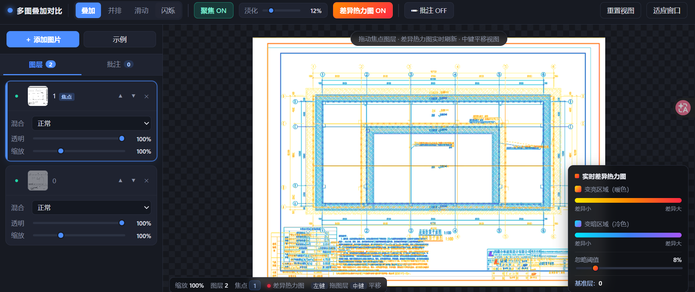

英文版 README.en.md：

```markdown
# OverlayDiff

> Multi-image overlay comparison · Real-time difference heatmap · Annotation & review

[](https://www.apache.org/licenses/LICENSE-2.0)
[]()
[]()

OverlayDiff is a browser-based multi-image overlay comparison tool that supports layer stacking, real-time difference heatmaps, annotations, and focus viewing. No installation required—just open and use. It is ideal for engineering drawings, design mockups, version iterations, and other scenarios requiring quick difference comparison and review annotation.

## Description

OverlayDiff is built with pure HTML + CSS + JavaScript and rendered via the Canvas 2D API. It has zero third-party dependencies and runs as a single file. It provides four comparison views (Overlay, Side-by-Side, Slider, Blink), pixel-level difference heatmaps, region-based annotations for review, and a focus mode to quickly highlight the layer of interest.

## Features

### 1. Multi-Layer Overlay & Management

- Add multiple images via button selection or drag-and-drop onto the canvas
- Layer list supports reordering, move up/down, show/hide, and delete
- Each layer can independently adjust opacity, scale, and blend mode (Normal, Difference, Multiply, Screen, Overlay, Darken, Lighten, Exclusion)
- Built-in demo images for instant trial

### 2. Four Comparison Views

- **Overlay**: All layers are stacked with their respective blend modes, ideal for precise alignment
- **Side-by-Side**: All visible layers are tiled horizontally for a general overview
- **Slider**: Drag the split line to compare two images left and right
- **Blink**: Automatically alternates between two images to quickly spot differences

### 3. Real-Time Difference Heatmap

- Pixel-level difference calculation rendered as a heatmap overlay
- Warm colors (yellow → orange → red) indicate brightening; cool colors (cyan → blue → purple) indicate darkening. Deeper colors mean greater differences.
- Adjustable ignore threshold to filter out minor differences
- Real-time refresh while dragging layers (fast low-resolution preview, high-quality refinement on release)
- Can be toggled on/off at any time. When off, images are displayed as semi-transparent overlays for visual comparison.

### 4. Focus Viewing

- Click a layer to set it as the focus layer; the focus layer stays sharp while others fade out
- Adjustable fade intensity for quick emphasis on the area of interest
- Only effective when the difference heatmap is enabled, avoiding interference with normal comparison

### 5. Annotation & Review Marking

- Enable annotation mode to draw rectangular regions on the canvas
- Supports entering review content, issue descriptions, or notes
- Annotation boxes are displayed with colored borders and numbers; all annotation text is always visible
- Selected annotations are highlighted with glowing borders and connector lines
- Annotation coordinates are stored normalized and follow layer movement and scaling automatically
- Annotation list supports quick navigation, editing, and deletion

### 6. View Controls

- Scroll wheel to zoom, middle-button drag to pan
- One-click reset view and fit-to-window
- Real-time display of zoom level and layer count

## Quick Start

### Requirements

- Any modern browser (Chrome, Edge, Firefox, Safari)
- No Node.js, no build tools required

### Run Directly

1. Download or clone this project
2. Double-click `index.html`
3. Click "Demo" to load built-in test images, or click "Add Image" / drag and drop your own images

### Run with a Local Server (Optional)

```bash
# Python 3
python -m http.server 8080

# Or Node.js
npx serve .
